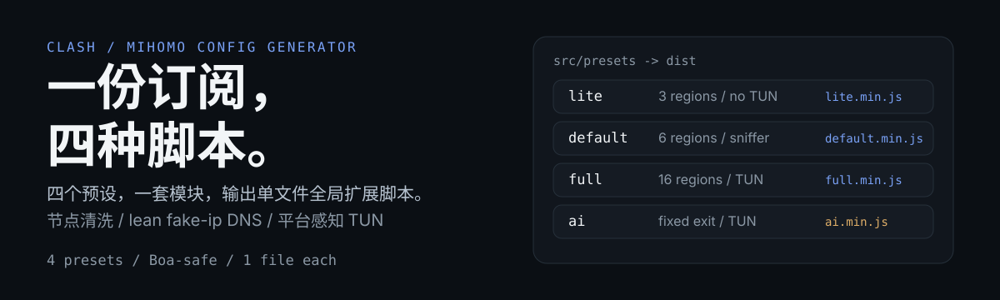
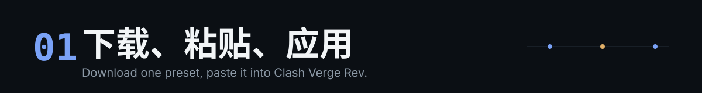
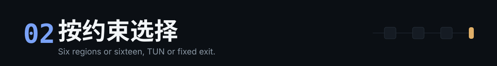
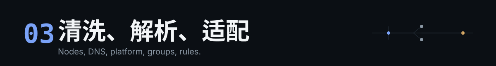

# Clash Script Adapter

把 Clash/Mihomo 订阅配置转换成可直接粘贴到 Clash Verge Rev 的全局扩展脚本。四个预设共用一套模块；构建时把 preset 的 `features` 读取替换为字面量，再由 esbuild 打包、Terser 删除未启用分支。

<p align="center">
  
</p>

[](https://github.com/bfmhno3/clash-script-adapter/releases)

`npm test` 运行测试套件，`npm run build` 生成四份 `dist/*.min.js`。

- 产物：`lite` / `default` / `full` / `ai`，24-30 KB，gzip 7.9-9.6 KB
- 运行环境：Clash Verge Rev 的全局扩展脚本（`boa_engine`），不使用网络或文件 API；其他客户端未验证
- 输入：订阅配置对象；输出：改写后的配置对象

<p align="center">
  
</p>

## 快速开始

直接使用发布产物：

```bash
curl -L -o lite.min.js https://github.com/bfmhno3/clash-script-adapter/releases/latest/download/lite.min.js
```

Release 资产可能落后于源码；需要本文档描述的最新 flag / NTP 行为时，从源码构建。

1. 把 `lite` 替换为需要的预设：`default`、`full` 或 `ai`。
2. 打开 Clash Verge Rev 的全局扩展脚本，粘贴 `*.min.js` 全文，保存并重新应用配置。
3. 在代理组中选择节点。未命中规则的流量默认进入 `♻️ Auto Select`；`ai` 在 `🔒 Fixed Exit` 中选择唯一出口。

`lite` 不含 TUN 和 Sniffer。需要透明代理时使用 `full` 或 `ai`。首次使用建议从 `default` 开始。

### 从源码构建

需要 Node.js（`mise.toml` 固定为 LTS）和 npm：

```bash
mise install
npm ci
npm run build
```

不使用 mise 时，安装 Node.js LTS 后执行 `npm ci && npm run build`。构建脚本遍历 `src/presets/*.js`，读取对应的 `src/features/<preset>.js`，替换 features 读取后打包，输出到 `dist/`。

### 验证

```bash
npm test
npm run check
```

`npm test` 运行测试套件；`npm run check` 额外构建四个预设。

<p align="center">
  
</p>

## 方案对比

| 预设 | 地区组 | TUN | Sniffer | NTP | 代理组 | 规则条数 | 产物 (min / gzip) | 适用场景 |
|---|---|---:|---:|---:|---:|---:|---|---|
| `lite` | 3 (HK, US, JP) | - | - | - | 18 | 26 | ~25 KB / 7.9 KB | 路由器、低性能设备 |
| `default` | 6 (HK, US, JP, SG, TW, KR) | - | yes | yes | 34 | 46 | ~29 KB / 9.2 KB | 桌面客户端、通用场景 |
| `full` | 16 | yes | yes | yes | 32-48 | 47 | ~30 KB / 9.6 KB | 透明代理、全量规则 |
| `ai` | 无 | yes | yes | yes | 3 | 25 | ~25 KB / 8.0 KB | 固定单一出口 IP |

`full` 的代理组数量随可用地区节点裁剪；没有真实节点的地区组会被移除。产物大小为当前源码的本地构建实测。

## 为什么用这个

- **改动集中在一处。** 地区正则、规则顺序、节点清洗、DNS 和平台参数都在 `src/modules/`；改一次，四个预设都受影响。手写多份全局脚本时，这些逻辑需要逐份同步。
- **一套源码，四个产物。** `src/presets/*.js` 只负责编排，`src/features/*.js` 决定生成哪些地区组、代理组和规则。构建时把 preset 的 `features` 读取替换为字面量，Terser 删除未启用的规则和组；源码仍保留统一模块，测试可以直接切换 flags。
- **输出是单文件脚本。** 不需要额外服务或运行时依赖；粘贴到客户端即可，脚本本身不发起网络请求。
- **预设对应不同约束。** `lite` 面向低资源设备，`default` 面向桌面，`full` 打开 TUN 和全部地区，`ai` 用固定出口避免自动测速造成的 IP 跳变。
- **节点清洗和平台检测内置。** 每个预设都会剔除信息节点、非法节点和重名节点，并按运行平台生成 TUN 参数。
- **代价。** 这是生成器，不是 GUI；修改预设后需要用 Node.js 重新构建。少量共享常量仍会留在产物中。

不适合以下场景：

- 只需要一份静态 YAML，不需要脚本生成。
- 客户端不支持全局扩展脚本。
- 需要清洗 `proxy-providers` 中的节点。远端 provider 的内容在脚本运行时不可读，清洗只作用于 `config.proxies`。

<p align="center">
  
</p>

## 它做了什么

### 节点清洗

所有预设都会在地区分类前处理 `config.proxies`：

- 名称命中 `剩余流量`、`到期`、`官网`、`客服`、`公告`、`traffic`、`expire` 等信息节点关键字。
- `name`、`type`、`server`、`port` 缺失或非法，包括 `0.0.0.0`、`127.0.0.1`、`localhost`、示例域名、非 1-65535 端口。
- 节点名重复时保留第一个。

清洗就地改写 `config.proxies`，随后重新生成代理组。`default`、`full`、`ai` 会输出 `proxies-cleaned` 统计日志，不包含节点名。

### DNS

默认使用 lean fake-ip 模式：

- `nameserver` 只保留阿里和腾讯 DoH，`proxy-server-nameserver` 使用同一组服务器。
- 代理域名立即返回 fake IP，交给远端解析；直连域名走国内 DoH。
- 不配置 `fallback`、`fallback-filter`、`nameserver-policy`、`direct-nameserver`，`respect-rules` 为 `false`。
- `cache-algorithm` 为 `arc`；IPv4 fake-ip 为 `198.18.0.1/16`，IPv6 fake-ip 为 `2001:db8:9876::1/64`。
- `fake-ip-filter` 只保留 LAN、NTP、连通性检测和直连服务。加入代理域名会重新引入本地解析。

需要旧的完全隔离方案时，把对应 `src/features/<preset>.js` 顶部的 `DNS_STRICT` 改为 `true`：

```js
export const DNS_STRICT = true;
```

strict 模式恢复 `fallback`、`fallback-filter`、`nameserver-policy`、`direct-nameserver` 和 `respect-rules: true`。

### NTP

`default`、`full`、`ai` 写入以下的 `ntp` 配置，`lite` 会删除该字段：

| 字段 | 值 |
|---|---|
| `enable` | `true` |
| `server` | `time.cloudflare.com` |
| `port` | `123` |
| `interval` | `30` |
| `dialer-proxy` | `DIRECT` |
| `write-to-system` | `false` |

`interval` 的单位是分钟。NTP 只给内核协议提供时钟偏移，`write-to-system: false` 不修改系统时间。

### 跨平台参数

运行时通过 `navigator` 检测平台；mihomo 原生环境没有 `navigator` 时，从 `profilename` 中的 `_linux`、`_android`、`_win`、`_mac` 推断。

| 配置项 | Windows | macOS | Linux | Android |
|---|:---:|:---:|:---:|:---:|
| `auto-redirect` | - | - | yes | yes |
| `gso` / `gso-max-size` | - | - | yes | - |
| `include-android-user` | - | - | - | yes |
| `routing-mark` | - | - | yes | - |
| `find-process-mode` | strict | strict | strict | off |
| `disable-keep-alive` | yes | yes | yes | yes |
| `strict-route` | yes | yes | yes | yes |

`strict-route` 由 TUN 配置统一设置，因此只在 `full` 和 `ai` 产物中出现。平台无法识别时，`routing-mark` 也会写入。

### 代理组

地区组和 `♻️ Auto Select` 使用 `url-test`；`🚀 Manual Select`、`🎯 Direct`、AI、流媒体和特殊服务组使用 `select`。

`🤖 AI Services` 的首选项依次为 US、SG、JP、HK。`📹 YouTube` 的首选项依次为 HK、JP、SG、TW，因为 Clash 客户端会把 select 组的第一项作为初始选择。

`ai` 预设只生成三个 `select` 组：

| 组 | 内容 | 用途 |
|---|---|---|
| `🔒 Fixed Exit` | 全部原始节点，按 US、SG、JP、HK、其余排列 | `MATCH` 与 AI 规则；用户在此选定唯一出口 |
| `Ⓜ️ Microsoft Services` | `DIRECT` + 全部原始节点 | 默认直连，可手动切换 |
| `🍎 Apple Services` | `DIRECT` + 全部原始节点 | 默认直连，可手动切换 |

`ai` 不生成 `♻️ Auto Select`、`🚀 Manual Select`、地区 `url-test` 组、`🐟 Final` 和 `🎯 Direct`，因此不存在自动测速导致的出口 IP 跳变。没有真实节点时，`🔒 Fixed Exit` 退化为 `['DIRECT']`。`ai` 默认同时开启 TUN 与 IPv6。

### 规则

| 类别 | 规则 | 目标 |
|---|---|---|
| 基础 | `GEOSITE(private)`、`RULE-SET(private_IP)`、`RULE-SET(Custom_*)`、`RULE-SET(giveup_*)` | `Direct`，`giveup_proxy` / `Custom_Proxy` 走代理 |
| 流媒体 | `GEOSITE(youtube/netflix/disney/hbo/spotify/...)` | 对应流媒体组 |
| AI | `GEOSITE(openai/google-gemini/category-ai-!cn)` | `AI Services` |
| 社交 | `GEOSITE(category-communication/social-media/github/...)` | 对应服务组 |
| 游戏 | `GEOSITE(steam/category-games)` | `Gaming` / `Steam` |
| 特殊 | `GEOSITE(paypal)` | `PayPal` |
| 兜底 | `GEOSITE(cn)`、`RULE-SET(cn-ip)`、`MATCH` | `Direct` / `Final`（`ai` 为内置 `DIRECT` / `Fixed Exit`） |

`ai` 的规则顺序为：基础规则、AI 规则、Apple/Microsoft、国内直连、`MATCH`。AI 规则排在 Apple/Microsoft 之前，避免 AI 域名被后两者截获。

## 配置与日志

每个预设的静态配置在 `src/features/<preset>.js`：地区列表、代理组开关、规则开关、`tun`、`sniffer`、`ntp`、`DNS_STRICT`、`LOGGING_ENABLED`、`LOGGING_LEVEL`。关闭 `tun`、`sniffer` 或 `ntp` 时，会删除输入订阅中的同名字段。

日志默认策略：

| Preset | Enabled | Level |
|---|:---:|---|
| `lite` | no | `silent` |
| `default` | yes | `info` |
| `full` | yes | `info` |
| `ai` | yes | `info` |

等级为 `trace`、`debug`、`info`、`warn`、`error`，`silent` 和 `off` 关闭输出。格式示例：

```text
2026-01-02T03:04:05.006Z WARN clash-script-adapter.preset.default empty-proxies-fallback platform=linux proxyCount=0
```

日志只记录平台、数量和功能摘要，不输出节点名、`secret` 或完整配置。

## 仓库结构

```text
src/
+-- presets/      入口：组合模块与 features
+-- features/     编译开关：地区、代理组、规则、DNS、日志
+-- modules/      可复用构建器：平台、清洗、地区、代理组、规则、DNS、网络、日志
test/             与模块和预设对应的测试
dist/             构建产物（gitignored）
build.js          features 常量替换 + esbuild bundle + Terser minify
```

## 参考项目

- [Aethersailor/Custom_OpenClash_Rules](https://github.com/Aethersailor/Custom_OpenClash_Rules) - 规则集来源
- [mihomo wiki](https://wiki.metacubex.one/) - 官方配置文档
- [Clash Verge Rev](https://github.com/clash-verge-rev/clash-verge-rev) - 客户端

## 许可证

MIT，见 [LICENSE](LICENSE)。
